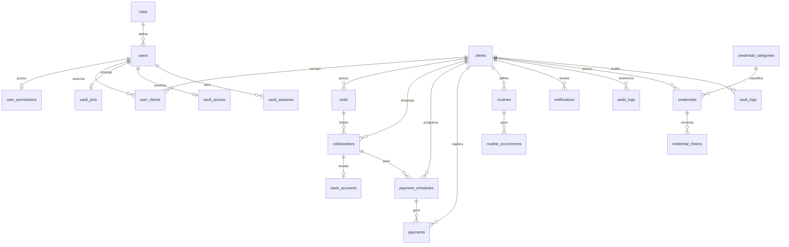
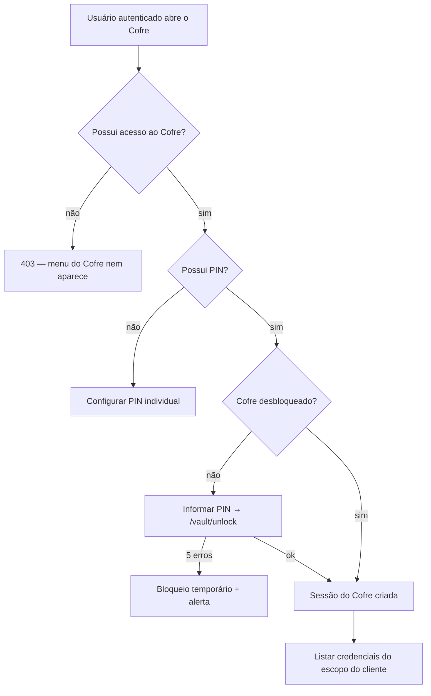

# Arquitetura, Fluxos e Plano de Segurança

Documento de entrega conforme o item **§33** da especificação. Cobre a estrutura
do banco, o diagrama de entidades, o mapa de telas, os fluxos principais, as
regras de recorrência e permissões e o plano de segurança/critérios de aceite.

---

## 1. Estrutura do banco de dados

Banco **relacional** (SQLite via `better-sqlite3`), normalizado — nenhuma entidade
concentra tudo em uma única tabela. Todas as tabelas com dados de cliente carregam
`client_id` para permitir o isolamento multiempresa.

### Grupos de entidades (§31)

| Domínio | Tabelas |
|--------|---------|
| Identidade & acesso | `roles`, `users`, `user_permissions`, `user_clients`, `user_units` |
| Clientes & unidades | `clients`, `units` |
| Colaboradores | `collaborators`, `bank_accounts` |
| Pagamentos | `payment_schedules`, `payments` |
| Rotinas | `routines`, `routine_occurrences` |
| Documentos & comunicação | `documents`, `notifications` |
| Auditoria | `audit_logs` |
| **Cofre de Credenciais** | `credential_categories`, `credentials`, `credential_history`, `vault_pins`, `vault_access`, `vault_sessions`, `vault_logs` |
| Configuração | `settings` |

### Decisões de segurança no modelo

- `credentials.password_enc` / `pin_enc` guardam **apenas ciphertext AES-256-GCM** —
  nunca texto simples.
- `vault_pins.pin_hash` é **hash irreversível** (bcrypt); o PIN nunca é decifrado.
- `credential_history` registra **quais campos** mudaram, jamais os valores.
- A **chave de criptografia** do Cofre **não** é um registro do banco — vive no
  ambiente (`VAULT_MASTER_KEY`) e é derivada por `scrypt` em runtime.

## 2. Diagrama de entidades (ER)

## 3. Mapa de telas (§28)

As 37 telas da especificação foram consolidadas em uma SPA. Correspondência:

| Área | Telas cobertas |
|------|----------------|
| **Autenticação** | Login · 2FA · Recuperação de senha |
| **Painel geral** | Dashboard geral · Calendário geral · Central de notificações · Relatórios |
| **Clientes** | Lista de clientes · Cadastro de cliente · Painel individual (abas) |
| **Cliente → abas** | Visão geral · Colaboradores · Pagamentos · Rotinas · Calendário individual · Unidades · Cofre |
| **Colaboradores** | Lista · Cadastro · Detalhes · Dados bancários (mascarados) · Contratação |
| **Pagamentos** | Programação (com prévia) · Lista · Detalhes · Ação em lote |
| **Rotinas** | Lista · Cadastro (com prévia de recorrência) · Detalhes/ocorrências |
| **Administração** | Usuários e permissões · Configurações · Logs de auditoria |
| **Cofre** | Validação do PIN · Painel geral do Cofre · Cofre por cliente · Cadastro/Detalhes/Alteração de credencial · Histórico · Usuários autorizados · Permissões do Cofre · Redefinição de PIN · Logs de acesso · Alertas |

## 4. Fluxos principais

### 4.1 Cadastro de cliente (admin)
`Clientes → Novo cliente` → formulário (dados da empresa + responsável + status)
→ `POST /api/clients` → auditado → painel individual criado com abas.

### 4.2 Cadastro de unidade
`Painel do cliente → Unidades → Nova unidade` → `POST /api/clients/:id/units`.
Uma empresa pode ter várias unidades; colaboradores/credenciais podem vincular-se a elas.

### 4.3 Cadastro de colaborador
`Colaboradores → Novo colaborador` → dados pessoais + profissionais + forma de
contratação (campos complementares por tipo) → `POST /api/collaborators`.
Dados bancários em seção própria, exibidos **mascarados**; ver completo exige
permissão `view_bank_full` e é **auditado**.

### 4.4 Agendamento de pagamentos (§7)
`Pagamentos → Programar` → escolhe colaborador + periodicidade + valor →
**`POST /api/payments/preview`** mostra a prévia das datas → confirma →
`POST /api/payments/schedule` cria o `payment_schedule` e gera os `payments`.
Controle por status, pagamento parcial, reagendamento, cancelamento e
**baixa em lote** (`/payments/bulk-pay`).

### 4.5 Cadastro de rotinas (§11–§12)
`Rotinas → Nova rotina` → dados + recorrência → **prévia** (`/routines/preview`)
→ `POST /api/routines` gera as ocorrências. Ocorrências podem ser concluídas
(com evidência), reagendadas ou canceladas.

### 4.6 Autenticação de usuário
`Login` → `POST /api/auth/login` (bcrypt + bloqueio por tentativas) → se 2FA
habilitado, exige código → emite JWT em cookie `httpOnly`. `GET /api/auth/me`
reidrata a sessão.

## 5. Fluxos do Cofre de Credenciais

### 5.1 Acesso por PIN

### 5.2 Revelar/copiar senha (§20)
`Revelar` → **exige o PIN novamente** → servidor confere permissão + sessão válida
→ decifra AES → **registra no log** → devolve a senha **transitoriamente** (TTL);
a interface reoculta após o TTL e, na cópia, tenta limpar a área de transferência.
Credenciais **críticas** exigem 2FA do usuário habilitado.

### 5.3 Redefinição de PIN (§19.1)
Admin em `Cofre → Usuários & PIN → Reset PIN` → confirma **o próprio PIN** (prova de
identidade) → `POST /vault/access/:id/reset-pin` → apaga o hash do PIN alvo e
**encerra todas as sessões** do Cofre daquele usuário; ele define novo PIN no
próximo acesso. O PIN antigo nunca é recuperado.

### 5.4 Cadastro de credencial
`Cofre → Nova credencial` → dados + senha + **confirmação do PIN** →
`POST /vault/credentials` (senha cifrada AES) → histórico `created` (sem valores).

## 6. Regras de recorrência (§7, §12)

Motor único em `server/recurrence.js`:

- **Frequências:** diária, semanal, quinzenal, mensal, datas específicas,
  personalizada.
- **Parâmetros:** data inicial/final, dias da semana, intervalo em semanas, dias do
  mês (com _clamp_ para meses curtos), múltiplas datas específicas.
- **Fim de semana/feriado:** `keep` (manter), `anticipate` (antecipar) ou
  `postpone` (adiar) para o dia útil mais próximo.
- **Prévia obrigatória** antes de salvar (endpoints `/preview`).
- **Limite** de 730 ocorrências como salvaguarda contra geração descontrolada.

## 7. Regras de permissões (§14, §21, §32)

Validação **sempre no servidor** (a interface nunca é a fonte de verdade).

| Perfil | Escopo | Destaques |
|--------|--------|-----------|
| **Administrador geral** | Todos os clientes | CRUD de clientes/usuários, dados bancários completos, auditoria, configurações, gestão do Cofre |
| **Consultor** | Clientes autorizados | Colaboradores, pagamentos, rotinas, relatórios; Cofre quando autorizado |
| **Cliente** | Apenas a própria empresa | Visualiza colaboradores/pagamentos/rotinas, aprova pagamentos, conclui tarefas |
| **Operacional** | Atividades atribuídas | Atualiza status/observações/evidências; sem dados bancários e sem Cofre |

**Permissões do Cofre são independentes** das permissões comuns
(`vault_access.permissions`): acessar, visualizar, revelar, copiar, cadastrar,
editar, excluir, exportar, histórico, logs, gerir usuários, redefinir PIN.

## 8. Estrutura dos logs de auditoria (§23)

- **`audit_logs`** (geral): usuário, cliente, ação, entidade, IP, dispositivo,
  data/hora. Registra login, alterações, acesso e edição de dados bancários,
  revogação de usuários etc. Sem endpoints de alteração/remoção → **imutável**.
- **`vault_logs`** (Cofre): desbloqueio, visualização, revelação, cópia, criação,
  alteração, exclusão, redefinição de PIN, tentativas negadas, bloqueios.
  **Nunca** registra senha, PIN ou códigos secretos.

## 9. Plano de segurança e proteção de dados (§22, §26, §32)

- **Autenticação:** bcrypt (senhas e PINs), JWT `httpOnly`+`SameSite=Strict`
  (`Secure` em produção), bloqueio por tentativas (login e PIN), 2FA (demo).
- **Isolamento por cliente** validado no servidor em toda consulta/relatório.
- **Criptografia em repouso:** AES-256-GCM para credenciais; chave derivada por
  `scrypt` a partir de segredo de ambiente, **fora do banco**.
- **Mascaramento:** CPF/CNPJ, conta e chave PIX exibidos parcialmente; ver
  completo exige permissão e gera log.
- **Cabeçalhos/HTTP:** Helmet + CSP restritiva (`script-src 'self'`), sem segredos
  em URLs, erros ou HTML.
- **Rate limiting** global e no login (força bruta / acesso automatizado).
- **Sessão do Cofre** com expiração por inatividade e revogação em massa.
- **Revogação imediata** de usuários desligados (encerra sessões e acesso ao Cofre).
- **LGPD:** dados fictícios em demonstração, registro de acesso a dados sensíveis,
  histórico de alterações, base para consentimento/anonimização/retenção.

## 10. Critérios de aceite da primeira versão (§33)

A primeira versão funcional entrega e valida:

- [x] Cadastro de clientes, unidades e colaboradores.
- [x] Dados bancários com mascaramento e auditoria de acesso completo.
- [x] Formas de contratação com campos complementares.
- [x] Programação de pagamentos com **prévia** de datas e recorrência.
- [x] Controle de pagamentos (status, parcial, reagendar, cancelar, baixa em lote).
- [x] Calendário individual e calendário geral com filtros e totais.
- [x] Rotinas com recorrência e prévia de ocorrências; conclusão com evidência.
- [x] Usuários, perfis e **permissões configuráveis** validadas no servidor.
- [x] **Cofre de Credenciais** com **PIN individual por usuário**, criptografia
      reversível das senhas, revelar/copiar auditados e reoculta automática.
- [x] Logs de auditoria (geral e do Cofre) imutáveis, sem conteúdo sensível.
- [x] Notificações (gerais e do Cofre) sem expor segredos.
- [x] Dashboards geral e individual por cliente.
- [x] **Isolamento multiempresa** verificado (usuário de uma empresa não acessa outra).
- [x] Identidade visual (nome/logo/cores) configurável.
